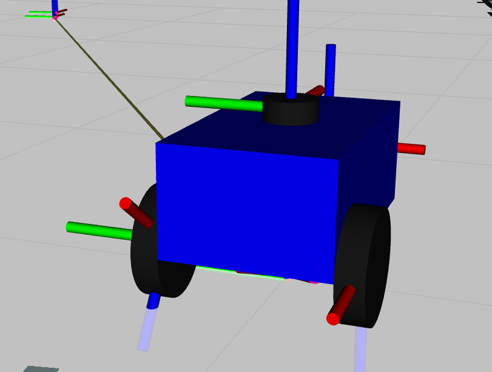
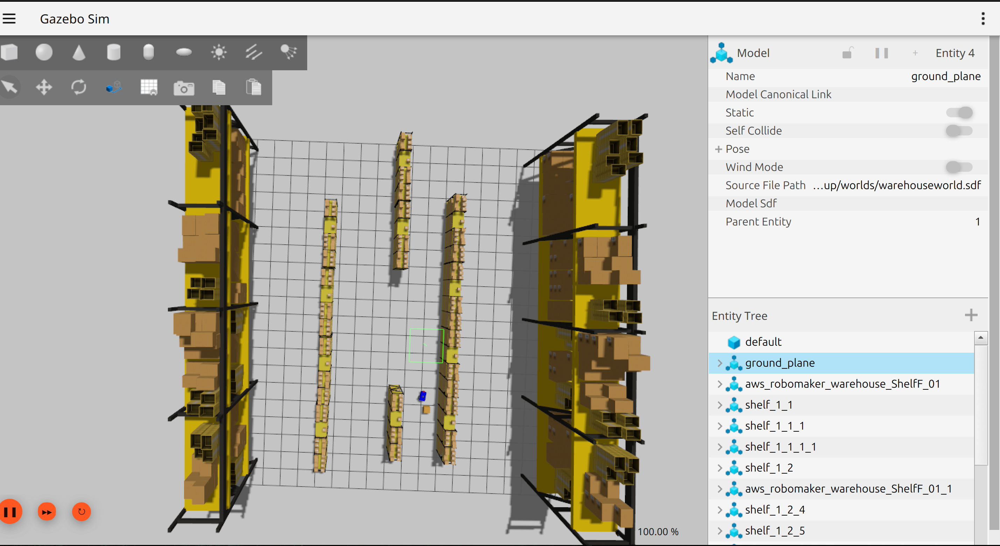
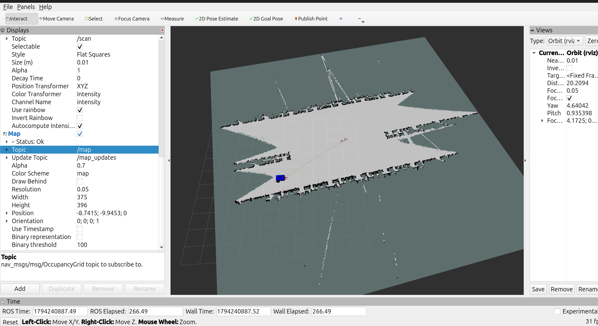
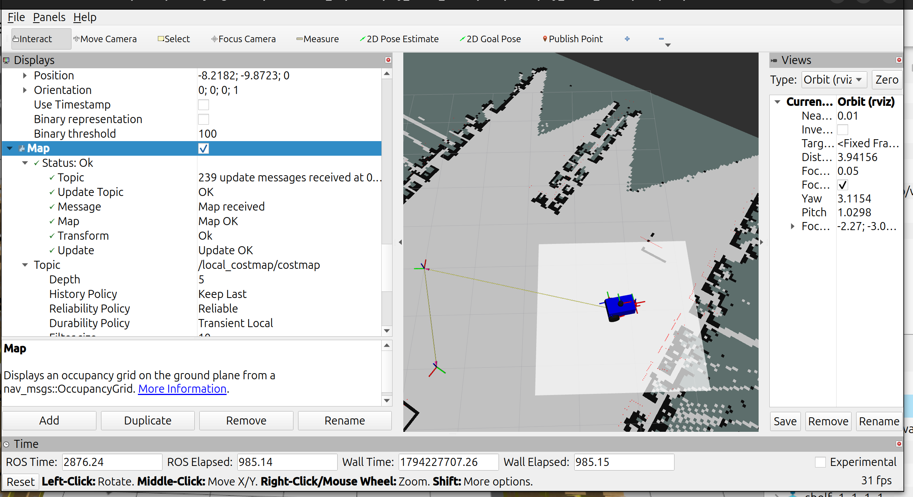

# Warehouse Robot Simulation using ROS 2

A simulated warehouse robotics system built using **ROS 2 Jazzy, Gazebo Sim, Nav2, SLAM Toolbox and C++**.

The project simulates an autonomous warehouse robot capable of navigating between warehouse stations, avoiding obstacles, accepting delivery tasks dynamically, and performing simulated package pickup and delivery.

## Features

- **Gazebo Simulation:** Simulated warehouse environment and differential-drive robot.
- **SLAM:** Warehouse mapping using SLAM Toolbox.
- **Autonomous Navigation:** Point-to-point navigation using Nav2.
- **Obstacle Avoidance:** LiDAR-based obstacle detection and costmap integration.
- **Mission Management:** C++ ROS 2 node for managing warehouse missions.
- **Task Prioritisation:** Priority queue for scheduling delivery tasks.
- **Dynamic Task Submission:** Submit new warehouse tasks through a custom ROS 2 service.
- **Simulated Package Delivery:** Package position is updated in Gazebo to simulate pickup, transport and delivery.
- **Mission Controls:** Pause, resume, cancel and inspect mission status through ROS 2 services.

## Tech Stack

| Technology | Purpose |
|---|---|
| ROS 2 Jazzy | Robotics middleware |
| C++ | Mission manager and task management |
| Gazebo Sim | Robot and warehouse simulation |
| Nav2 | Autonomous navigation |
| SLAM Toolbox | Mapping |
| RViz2 | Visualisation and debugging |
| URDF / Xacro | Robot description |
| XML | ROS 2 launch files |
| YAML | Navigation and simulation configuration |

## Architecture

The system consists of four main ROS 2 packages:

```text
warehouse_ws/
└── src/
    ├── my_robot_description/
    │
    ├── robo_bringup/
    │   ├── config/
    │   ├── launch/
    │   └── worlds/
    │
    ├── warehouse_navigation/
    │   ├── config/
    │   ├── launch/
    │   ├── maps/
    │   └── models/
    │
    ├── warehouse_mission_manager/
    │   ├── include/
    │   └── src/
    │
    └── warehouse_interfaces/
        └── srv/
```

### Mission Execution Workflow

1. A warehouse task is submitted through the `SubmitTask` service.
2. The mission manager validates the task and adds it to a priority queue.
3. The robot navigates to the pickup station using Nav2.
4. The package is simulated as picked up.
5. The package follows the robot during transportation.
6. The robot navigates to the designated drop-off station.
7. The package is placed at the destination.
8. The task is marked as completed, and the next queued task is processed.

## Prerequisites

- Ubuntu 24.04
- ROS 2 Jazzy
- Gazebo Sim
- Nav2
- SLAM Toolbox
- RViz2
- `ros_gz` packages
- `colcon`

## Build Instructions

Clone the repository and enter the workspace:

```bash
git clone <YOUR_GITHUB_REPOSITORY_URL>
cd warehouse_ws
```

Source ROS 2:

```bash
source /opt/ros/jazzy/setup.bash
```

Build the workspace:

```bash
colcon build
```

Source the workspace:

```bash
source install/setup.bash
```

## Running the Simulation

Launch the complete warehouse system:

```bash
ros2 launch robo_bringup warehouse.launch.xml
```

The combined launch file starts the Gazebo environment, robot, required bridges, package model, SLAM, Nav2 and mission manager.

## Submitting a Warehouse Task

Tasks can be submitted dynamically while the mission manager is running.

Example:

```bash
ros2 service call /warehouse_mission/submit_task \
warehouse_interfaces/srv/SubmitTask \
"{task_id: 'TASK_101', pickup_station: 'storage_A', dropoff_station: 'loading_dock', priority: 5}"
```

Available warehouse stations:

- `storage_A`
- `packing_station`
- `loading_dock`

A higher integer priority is processed before a lower-priority task.

## Mission Control Services

The mission manager exposes the following services:

| Service | Purpose |
|---|---|
| `/warehouse_mission/submit_task` | Submit a new task |
| `/warehouse_mission/pause` | Pause the current mission |
| `/warehouse_mission/resume` | Resume mission execution |
| `/warehouse_mission/cancel` | Cancel the current mission |
| `/warehouse_mission/status` | Check mission status |

## Demonstrated Results

The system has been tested with:

- Gazebo robot spawning and teleoperation.
- SLAM-based warehouse mapping.
- Nav2 autonomous navigation between warehouse stations.
- LiDAR-based dynamic obstacle avoidance.
- Sequential warehouse task execution.
- Dynamic task submission through a custom service.
- Priority-based task scheduling.
- Simulated package pickup, transportation and delivery.

A dynamic task submission test successfully completed `TASK_101`, navigating from `storage_A` to `loading_dock` and delivering the simulated package.

## Limitations

- Package pickup and delivery are simulated through Gazebo model pose updates; no physical robotic gripper is implemented.
- The package is visual-only to avoid collision interference with navigation.
- The environment and robot are simulated rather than deployed on physical hardware.
- Task persistence across restarts is not implemented.

## Future Improvements

- Robotic arm integration for physical package manipulation.
- Persistent task storage.
- Multi-robot warehouse coordination.
- More advanced warehouse scheduling.


## Project Screenshots

### Robot Model


### Warehouse Simulation


### SLAM Mapping and Visualisation


### Dynamic Obstacle Avoidance


*Built as a robotics engineering project using ROS 2, C++, Gazebo and Nav2.*